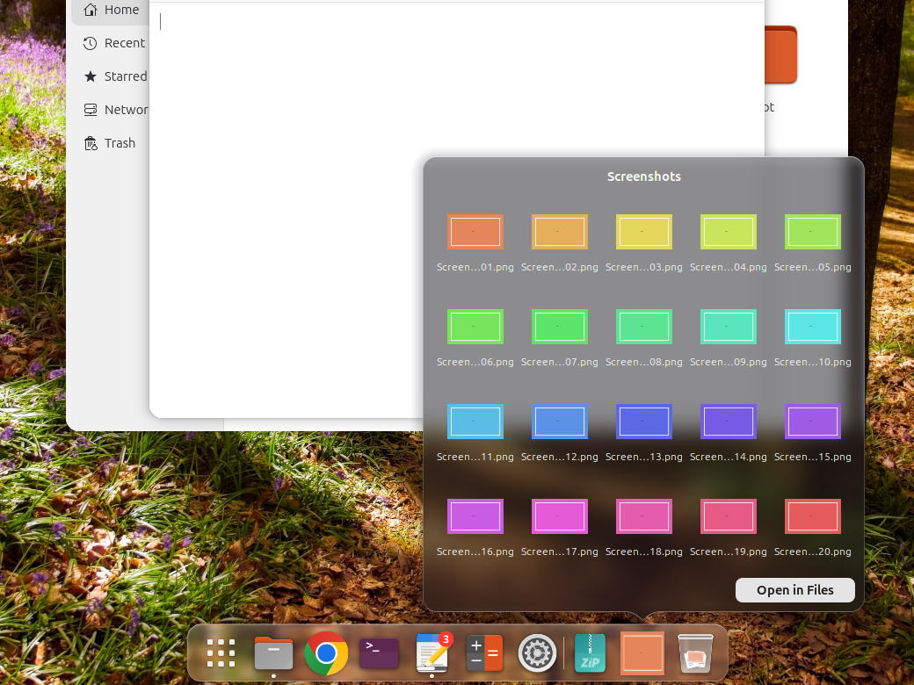
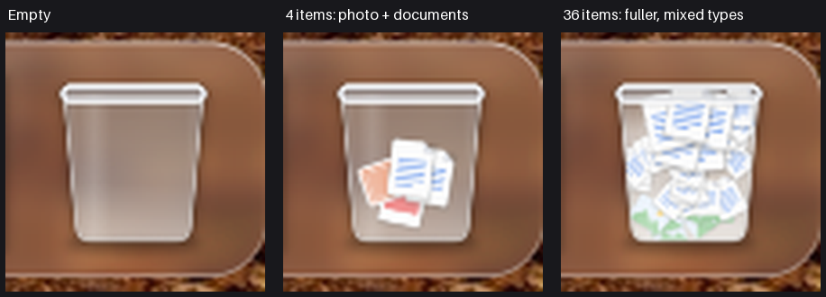

# Hyperdock

A macOS-style dock for GNOME Shell 50 (Ubuntu 26.04, Wayland): Liquid Glass platter, icon magnification,
genie minimize, folder stacks, a glass Trash that shows what is in it, and Finder-style drag and drop.

Hyperdock is a fork of [Dash2Dock Animated](https://github.com/icedman/dash2dock-lite) by icedman (GPL-3.0),
built for GNOME 50 only. Original authorship and the GPL-3.0 license are kept; see [LICENSE](LICENSE).


| Folder stack (Grid view) | Glass Trash (empty, 4 and 36 items) |
|---|---|
|  |  |

The images come from an isolated headless GNOME Shell 50.1 session (1920x1080).

## What is different

Every row: what upstream Dash2Dock Animated does, then what Hyperdock does. All new features are settings; the
macOS look is a preset (the [ubuntu-tweaks](https://github.com/alex-mextner/ubuntu-tweaks) `dock.ini`), upstream
defaults are kept and nothing of upstream was removed.

### Hyperdock vs Dash2Dock Animated

| Area | Dash2Dock Animated | Hyperdock |
|---|---|---|
| Background | Flat background, or [Blur my Shell](https://github.com/aunetx/blur-my-shell) | Liquid Glass platter: GPU blur, edge refraction, bright rim, soft shadow, drawn by the dock itself |
| Colors | Fixed colors | Adaptive contrast: Apps grid, separators and running dots follow the wallpaper's brightness |
| Separators | Drift, about 7 px off the platter centre in a vertical dock | Centered on the platter at rest and while magnified |
| Trash | Theme trash icon | Glass bin like macOS 26: fill level grows with the item count, newest 5 items shown as thumbnails or type cards |
| Folder stacks | Downloads only; fan only, "Open Window" menu, box overlapping the dock | Any folder is a stack (`folder-stacks`); Fan, Grid and List views, Sort by, Display as Folder/Stack, picture previews, hidden files skipped, per-stack menu; the popover floats above the dock with a notch aimed at the icon; "Open" opens the folder itself |
| Badges | No badge by default, a 2 px dot | Red count badge, Unity LauncherEntry counts, progress bar and urgent state |
| Minimize | Into the top-left corner, no genie, no tiles | Own GPU genie effect (Magic Lamp is broken on Mutter 50), minimize into the app icon or into a tile of the window left of the Trash; click the tile to restore |
| Bounce | On dock click only, nothing for attention | Launch bounce from anywhere (Super+N, app grid, terminal), bounce for apps that need attention, which also reveals a hidden dock |
| Drag and drop | Not possible on Wayland | Drop files on Trash (moves to trash), on an app (opens with it) or on a stack (moves or copies); drag an icon off the dock to remove it with a poof; spring-loading raises an app under a dragged file |
| Windows | Per-icon actions | Show All Windows (per-app spread), isolate workspaces, recent apps section |
| Input | Click, scroll | Click-minimizes toggle, Shift+click new window, Open at Login in the icon menu, dock background menu, hide shortcut (Super+Alt+D), Ctrl+Alt+Tab keyboard focus into the dock, Super+number overlay |
| Autohide | Reveals as soon as the pointer is near the edge | Reveals only after the pointer rests on the edge for `reveal-delay-ms` (default 300 ms) |
| Stability | - | Fixes for a Shell crash when removing an icon under the pointer, inotify exhaustion, a GNOME 50 right-click exception, a layout recursion hang, stack paths with special characters, timers surviving Shell exit; `make install` refuses to install over a symlinked extension dir |
| GNOME versions | 42 to 50 | 50 only: the older-version code and build were removed |
| Donations | QR code and links to the upstream author | None; settings link to this repository and credit upstream |

### Hyperdock vs Dash to Dock (Ubuntu Dock)

[Dash to Dock](https://github.com/micheleg/dash-to-dock) is the extension behind Ubuntu Dock: a configurable
panel-style dock. Hyperdock is a different kind of dock:

| Dash to Dock | Hyperdock |
|---|---|
| Flat panel-style bar | Floating centered Liquid Glass platter |
| No icon magnification | Magnification under the pointer, bounce on launch |
| Optional Trash and mounted-volume icons; no folder stacks, no minimized-window tiles | Folder stacks, a Trash that shows its contents, mounted volumes and minimized-window tiles live in the dock |
| Shell's default minimize animation | Genie minimize |
| Works on GNOME versions before 50 | GNOME 50 only |

Hyperdock replaces Ubuntu Dock; it does not run alongside it (the ubuntu-tweaks module disables
`ubuntu-dock@ubuntu.com`).

## Features

Everything above is a setting in the preferences. Also inherited from upstream:

* Multi-monitor support
* Dock positions: bottom, top, left, right; autohide/intellihide
* Scroll wheel to cycle windows; click to maximize/minimize windows
* Style top panel, panel mode, show/hide Apps icon
* Analog clock, dynamic calendar, mounted devices
* Icon color effects (Tint, Monochrome), custom icons

### Third-Party Compatibility

* [Blur my Shell](https://github.com/aunetx/blur-my-shell)

## Screenshots still to capture

The images above are real captures from an isolated headless GNOME Shell 50.1 session. These have no capture
yet and need a live session (light/dark wallpapers, a dock with notifications, several open windows):

- [ ] Liquid Glass on a light wallpaper and on a dark wallpaper (adaptive contrast)
- [ ] Folder stack as Fan and as List popover
- [ ] Count badge and progress bar on an icon
- [ ] Show All Windows (per-app spread)
- [ ] Minimized-window tiles in the dock (still image next to the Trash)
- [ ] Side-by-side with the macOS 26 dock

## Installation

Requires GNOME Shell 50 (Ubuntu 26.04). For older GNOME versions use upstream Dash2Dock Animated.

### With ubuntu-tweaks (recommended)

[ubuntu-tweaks](https://github.com/alex-mextner/ubuntu-tweaks) vendors Hyperdock as a submodule, disables Ubuntu Dock,
applies the macOS preset (folder stacks, glass, genie, file drops) and migrates settings from a previous
dash2dock-lite install:

```bash
curl -fsSL https://raw.githubusercontent.com/alex-mextner/ubuntu-tweaks/main/scripts/bootstrap.sh | sh -s -- --yes
```

Log out and back in afterwards: GNOME on Wayland loads extension code only at login.

### Manual

```bash
git clone https://github.com/alex-mextner/hyperdock.git
cd hyperdock
make install                              # compiles the schema and installs into ~/.local/share/gnome-shell/extensions/
gnome-extensions disable ubuntu-dock@ubuntu.com
gnome-extensions enable hyperdock@alex-mextner.github.com
```

Log out and back in if the dock does not appear. `install.sh` installs a published release zip instead of building from source (once releases exist).

## Theme Support

Export your settings under **Style** > **Themes Button** > **"Export"**...

This will be saved to `/tmp/theme.json`. Edit this JSON file and save it under `~/.config/d2da/themes` or at `{extension_path}/themes` so that it becomes available in the extension settings app.

## Custom Icons

Create a folder under `~/.config/d2da/icons` and place your SVG icons there. Then create a file under `~/.config/d2da/icons.json` using the following format:

```json
{
  "icons": {
     "view-app-grid-symbolic": "icons/show-apps-icon.svg",
     "user-trash": "icons/my-own-trash.svg",
     "user-trash-full": "icons/my-own-trash-full.svg"
  }
}
```

You may also use **icon names** from your favorite icon theme using the following format:

```json
{
  "icons": {
     "view-app-grid-symbolic": "show-apps-icon",
     "user-trash": "trash",
     "user-trash-full": "trash-full"
  }
}
```

The icons `show-apps-icon`, `trash`, and `trash-full` must be available in your icon theme folder.

Alternatively, you may override icons via app ID:

```json
{
   "apps": {
      "spotify_spotify": "icons/spotify.svg"
   }
}
```

Check the logs to see the icon names currently being used by Hyperdock. Search for log text such as:

```sh
Icon created "user-trash"
```

## Custom Config

Create a file `config.json` under the folder `~/.config/d2da/`

```json
{
  "file-explorer": "nemo",
  "icon-size": "24"
}
```

* Disable then enable the extension to load the configuration
* `file-explorer` overrides the default "nautilus"
* `icon-size` overrides the icon scale from the preferences panel

## Custom CSS

Create a file `style.css` under the folder `~/.config/d2da/`

For now, you will have to use Looking Glass (GNOME's built-in debugger) to inspect class names and styles.

## Blurred Background

The blurred background feature requires **ImageMagick** to be installed on the system. This generates the blurred image based on the desktop wallpaper.

## Installing over a symlink

`make install` and `make install-zip` refuse to run when `~/.local/share/gnome-shell/extensions/hyperdock@alex-mextner.github.com` is a symlink, since installing would empty the checkout it points to; remove the link first to install a copy.

## Bug Reporting

When reporting bugs, please include the following details:

* Linux Flavor/Distribution and version
* GNOME version (e.g. 50.1)
* Hyperdock release number

Check for any exceptions in the logs by running the following in the terminal:

```bash
journalctl /usr/bin/gnome-shell -f -o cat
```

To check for incompatibilities with other extensions, try running Hyperdock with all other extensions disabled.

To check for lag or inefficiency, run the following in the terminal and observe `gnome-shell` CPU usage:

```bash
top -d 0.5
```

On a Dell XPS 13 (i5-6200U), CPU usage is about 50% with icon quality set to High, frame rate set to High, and shadows enabled.

Please be specific about the errors encountered, and attach screenshots if possible.

## Testing Rig

* Ubuntu 26.04 (GNOME 50, Wayland)

## License

Distributed under the GPL 3.0 License. See [LICENSE](LICENSE) for more information.

## Migrating from dash2dock-lite

Hyperdock is a separate extension from upstream Dash2Dock Animated and no longer shares its identity:

| | upstream | hyperdock |
|---|---|---|
| uuid | `dash2dock-lite@icedman.github.com` | `hyperdock@alex-mextner.github.com` |
| schema id | `org.gnome.shell.extensions.dash2dock-lite` | `org.gnome.shell.extensions.hyperdock` |
| dconf path | `/org/gnome/shell/extensions/dash2dock-lite/` | `/org/gnome/shell/extensions/hyperdock/` |

Disable the old extension, then carry your settings over:

```bash
dconf dump /org/gnome/shell/extensions/dash2dock-lite/ \
  | dconf load /org/gnome/shell/extensions/hyperdock/
```

`ubuntu-tweak apply` does this automatically.
