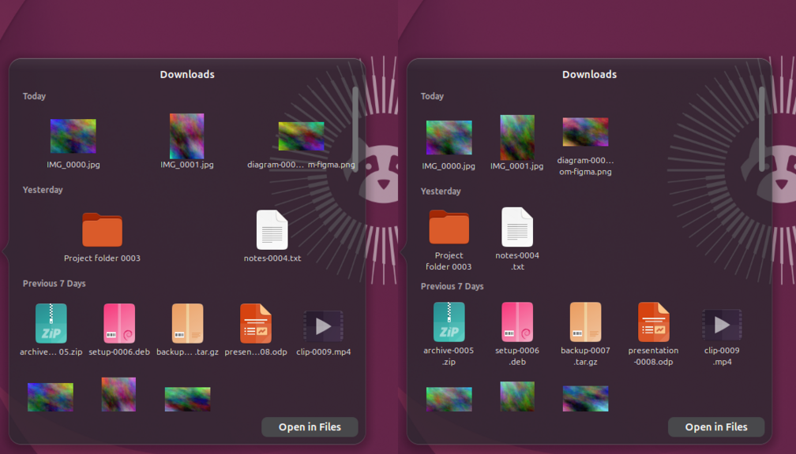

# Stacks: Recents, Downloads, Screenshots and the Trash

## What the user asked for

Recovered from the project tickets and the session history (2026-10-11, 2026-10-31); quoted verbatim.

- hyperdock#6, comment of 2026-10-11 13:30 (the original wish):
  «Давай сделаем недавние, загрузки и скриншоты в виде стопок, чтобы было видно что это не один элемент а несколько. недавние таким образом тоже будут сгруппированы и пусть находятся слева от загрузок за тем же разделителем
  стопки должны быть динамические, состоять из того что там на самом деле»
- the same ticket, 13:32:
  «и recent-apps-count=3 по умолчанию надо будет сдеалть таким же как у загрузок и скриншотов, 20?»
- ubuntu-tweaks session, 2026-10-10 15:08 (the dock spec): «док на ubuntu работает полностью как на маке но опенсорсный и гибкий. по умолчанию есть папки загрузки и скриншоты справа.»
- 2026-10-31: «почини работу с выпадушками в доке, например в Downloads ничего не кликается и не сделано пачками как я ранее просил (поищи ворктри и задачи) так же не сделано пачками недавние процессы и не объединены в одну группу с загрузками скриншотами и корзиной.»

"Пачками" is the same wish as "в виде стопок": the stack should look like several things, not one, and be made of what is really in it.

## How it is done

| Requirement | Where |
|---|---|
| A stack's dock icon is a visible pile of the newest real items (up to three overlapping, rotated pictures, type cards or app icons), redrawn when the folder or the app list changes | `stackModel.js` (`pileLayers`), `apps/stack-pile.js` (drawn in a separate process, like the glass Trash), `stackPile.js`; "Display as Stack" (the default for Downloads, Screenshots and Recents) |
| Dropdowns list the items in batches under headers: by date (Today, Yesterday, Previous 7 Days, Previous 30 Days, Earlier) or by kind (Folders, Images, Movies, Music, Documents, Archives, Applications, Other) | `stackModel.js` (`groupItems`), `stackPanel.js`; "Group by" in the stack menu, `downloads-stack-group` (default date), `group` in a `folder-stacks` entry |
| Recents are a stack too: the recently closed apps, in a pile, opening as a fan, grid or list of app icons; a click starts the app | `services.js` (`setupRecentsStack`), `stackSources.js` (`recentItems`), `recents-stack-view`, `recents-stack-display`; "Clear Recents" in its menu |
| Recents, Downloads, Screenshots (and other stacks), the minimized-window tiles and the Trash are one group behind one separator, Recents first | `stackDock.js`, `stackModel.js` (`clusterOrder`); the old "recent apps among the apps" section is gone |
| Screenshots is a stack by default | `stackSources.js` (`folderStackSpecs`): `<Pictures>/<Screenshots>` once that folder exists (`screenshots-icon`); a `folder-stacks` entry for the same folder takes it over |
| `recent-apps-count` as many as the other stacks | default 20 (was 0, range 0..50); an explicit value in dconf is kept |

### Choices where the wish was ambiguous

- Batches in the dropdown follow the macOS "Group By" idea (date added or kind). Recents has no timestamps (the list is ordered by when an app closed), so it stays one batch.
- The fan view is an arc of at most N items; batches apply to the Grid and List views.
- The built-in Screenshots stack appears once `<Pictures>/Screenshots` exists when the stacks are set up (enable, or a stack setting changes); a folder GNOME creates with the first screenshot is picked up at the next such rebuild. List the folder in `folder-stacks` to have it from the start.
- The default grouping is by date; "None" restores the flat list.

## Why the dropdown ignored clicks

Root cause, reproduced in a nested shell with a virtual pointer (`tools/stacks-shell.sh`): GNOME 50's `St.Button` is a click gesture and is cancelled when an ancestor handles the press. `StackPanel` returned `Clutter.EVENT_STOP` from `button-press-event` on both its popover and its full-monitor backdrop, so the press never completed a click: `pressed` went true then false and `clicked` was never emitted. The Downloads setting "Automatic" opens the Grid when there are more files than the fan holds, so Downloads was affected the moment it had more than a handful of files. Only a press outside the popover is handled (and closes the panel) now.

## Why the Grid was crooked

Reproduced on the real Screenshots folder and on a fixture of 1200 + 700 files (`D2DA_STACKS_BIG=1 tools/stacks-shell.sh`, scenario `stackopen`; the grid's rectangles are read back from the actors). Every batch (Today, Previous 7 Days, ...) was its own `Clutter.GridLayout` with `column_homogeneous`, which shares the batch's whole width among the columns it *uses*: a batch of one file sat in the middle of the row, a batch of two had its files 240 px apart, and only batches of five or more lined up with each other. Long names were cut in the middle to one line (`Screen…15.png`, the same for every screenshot).

Now the Grid is one column grid for the whole dropdown (`stackLayout.js`, pure and tested): each batch starts a new row under a header that spans the full width and fills the same columns from the left; the scrollbar has its own lane; a name takes two lines and a long one keeps its start over its end (`Screenshot…` over `16-10-04.png`); the column count follows the work area's width (at most five).

## Why the dropdown opened slowly

Measured in the nested shell, main-loop stalls while opening (timer jitter) on the same fixture, bottom dock, 1200x800:

| | before (click to first frame, longest stall) | after |
|---|---|---|
| Downloads, 1200 files (old code listed 200) | 6.0 s, 6.0 s stalled (4.4 s on the second open) | 35-43 ms, 28-54 ms stalled |
| Screenshots, 700 PNGs of 2560x1440 | 7.8 s (6.7 s) | 34-46 ms, 25-36 ms stalled |
| my real Screenshots folder, 33 PNGs | 1.9 s (1.9 s) | 33 ms, 28 ms stalled |
| listing 1200 files after a change | 379 ms in one piece | 102 ms in chunks, 7 ms longest stall |

Files that never had a thumbnail (a fresh screenshot, a photo just copied in) are the slow case that remains: the first frame is there at once with type icons (43-142 ms, the first open after login pays for the code being loaded), and the pictures follow as the worker makes them: a first page of 6 pictures (12 MP photos and 2560x1440 screenshots) took 0.7-1.5 s, a page of PNGs about 0.4-1.5 s; the dropdown never waits for them. After the first open they are in the thumbnail cache. Scrolling over files that have thumbnails costs one 60-100 ms step at most.

Root causes, each shown by timestamps around the calls (`GdkPixbuf.Pixbuf.get_file_info` took 2453 of the 2542 ms the panel needed for 60 pictures):

1. For every picture the panel asked gdk-pixbuf for the size of the **file itself** on the main loop: 20-40 ms per 2560x1440 PNG or 12 MP JPEG (gdk-pixbuf 2.44 loads through a sandboxed loader). 150 screenshots stalled the shell for 3.3 s.
2. It built the cell of **every** file (up to 200) before the first frame.
3. The thumbnail lookup knew only the `large` and `normal` cache folders (GNOME writes `x-large` on a 4K screen) and then decoded the whole screenshot.
4. Listing a folder was a synchronous `enumerate_children`/`next_file` loop plus an icon-theme lookup per file, on every change of the folder (379 ms for 1200 files).

What happens now:

| Concern | Where |
|---|---|
| The folder is listed in chunks without blocking the loop, newer listing cancels the older; a file's icon is looked up once per kind; the entry carries GIO's `thumbnail::path` (a current thumbnail, any size folder) | `stackFolder.js`, `services.js` (`checkFolderStack`) |
| Only the cells near the scroll window exist; the rest of the files are rectangles | `stackContent.js`, `stackLayout.js` (`visibleSlice`) |
| A picture with no thumbnail is made by another process (`apps/thumbnailer.js`, freedesktop cache, two workers, three files per run, what the open dropdown shows first, the first 40 files of a stack are made ahead after the folder is listed) and replaces the type icon when it is ready; nothing is decoded on the main loop | `stackThumbs.js`, `thumbQueue.js` |
| The fan uses the same pictures (it also asked for the file's size synchronously) | `dockItemMenu.js` |
| The model is kept between opens and relisted when the folder changes (file monitor, debounced) | `services.js` (`_watchStack`), unchanged |

Up to 1000 files of a stack are listed (it was 200); opening costs the same for ten files and for a thousand.

## Why the layout shortcut and Super did nothing while a dropdown was open

Root cause, reproduced in a nested shell with a virtual keyboard (`tools/input-grab-shell.sh`): `Main.pushModal()` filters every global keybinding through the action mode it is given, and `StackPanel` called it without one, so it got the default `NONE`, which blocks all of them (`windowManager.js` `_filterKeybinding`). Super+Space (input-source switch) and a tap of Super (`overlay-key`) were dropped; before the fix the scenario logged `actionMode: 0`, the input source stayed `us`, and the overview never opened. The dock's own menus (an app icon's, the dock's background menu) are `PopupMenu`s that grab with `POPUP`, which lets the input-source shortcut through, but the Shell allows `overlay-key` only in `NORMAL | OVERVIEW`, so Super was dropped there too.

Now every dock popover grabs with `POPUP` (`popoverInput.js`; the same mode the Shell's menus use, and the one under which `keyboard.js` switches the input source without opening its own switcher popup, which could not take a second grab on top of ours). While any popover is open `overlay-key` is also allowed in `POPUP` (counted, so overlapping popovers hand it back only when the last one closes), and a Super tap closes the popover as the overview shows, then toggles the overview as it does at rest (with the overview open, Super closes both). Known edge: a grab of the same mode opened on top of a dock popover by a keyboard shortcut (the screenshot UI, the calendar and quick-settings menus) lets Super open the overview over it while the dock popover is still open; no focus-based close is used because it would also fire for a drag started from the dropdown. Escape, a click outside and typing behave as before.

## Testing

- Pure rules: `tests/stack_*_check.js`, `tests/thumb_queue_check.js` (run by `make test`): batches, the grid's rectangles, which cells are on screen, the thumbnail queue, the listing of a real folder (`stackFolder.js`).
- Real input: `tools/stacks-shell.sh` boots a nested headless shell on a scratch data dir, clicks the stack items and the entries of their dropdowns with a virtual pointer (a stub `xdg-open` and stub app launchers prove the click arrived), checks the batch headers, the group's order and the single separator, and saves screenshots to `stacks-out/shots`.
- `D2DA_STACKS_BIG=1 D2DA_STACKS_SCENARIO=stackopen tools/stacks-shell.sh` times the opening (click to first frame, click to all pictures, longest main-loop stall) on Downloads and Screenshots with a fixture of hundreds of files and real full-size PNGs (`tools/stacks-fixture.py`); `D2DA_STACKS_POSITION` (0 bottom, 1 left, 2 right, 3 top) and `D2DA_STACKS_MONITOR` (WxH) vary the dock and the screen.
- Input grab: `tools/input-grab-shell.sh` opens the Downloads grid dropdown, an app icon's menu and the dock's menu in the nested shell and, with a virtual keyboard, sends Super+Space and a tap of Super; it fails unless the input source switched and the tap closed the popover and opened the overview. Escape, typing and a click outside are checked too. Pure rules: `tests/popover_input_check.js`.
